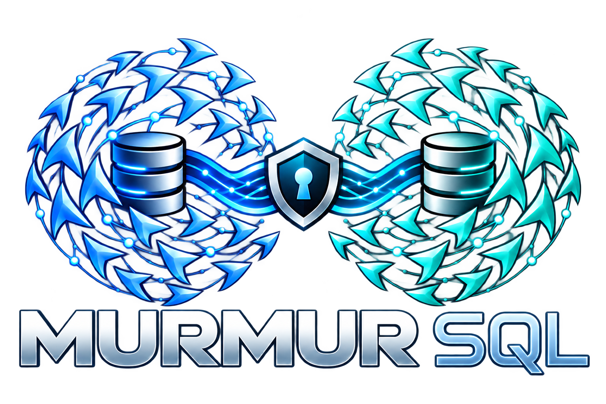

# libmurmur

<p align="center">
  
</p>

**libmurmur** is an embedded, in-process database library built on SQLite, designed for local-first, peer-to-peer applications requiring high write throughput and masterless replication.

Instead of writing SQLite pages to a standard filesystem file, libmurmur implements a custom SQLite Virtual File System (VFS) that routes storage directly into an embedded **RocksDB** LSM-tree engine. All stored records are transparently compressed with **zstd** and encrypted with **AEGIS-256** (or **AES-256-GCM**) using an **Argon2id**-derived keyring.

### Key Architectural Concepts

- **In-Process SQLite with RocksDB VFS**: Your application speaks standard SQLite SQL, but the underlying byte path never touches a conventional flat database file. RocksDB's LSM-tree architecture absorbs sequential and random mutations with exceptional efficiency.
- **High Write Throughput & Durability Trade-off**: Writes are buffered and flushed asynchronously (configurable, e.g., 100 ms dirty window). This delivers outstanding write speed (hundreds of thousands of operations per second) with an intentional, accepted trade-off: a bounded window of uncommitted data may be lost in the event of an abrupt process crash or power cut.
- **Offline-First, Masterless Replication**: Built-in multi-master replication powered by conflict-free replicated data types (CRDTs via `cr-sqlite`) and causal vector clocks. Applications read and write locally without network dependencies. When nodes meet, state reconciles deterministically without central servers, primary leaders, or split-brain locks.
- **QUIC / TLS Peer-to-Peer Transport**: Inter-node communication runs directly over native QUIC with mutual TLS (picoquic + mbedTLS), ensuring secure, authenticated point-to-point connections with custom URI SAN identities.
- **SWIM Gossip Failure Detection & Discovery**: Nodes discover peers, track liveliness, and exchange cluster membership updates over UDP datagrams using a bounded SWIM-style gossip protocol.
- **Rich Native Ecosystem**:
  - **Vector & Full-Text Search**: In-process embeddings similarity via `vec0` alongside SQLite `FTS5`.
  - **File Object Storage**: Large binary payloads stored with CRR metadata and stream-replicated over QUIC.
  - **CLI Tools**: Interactive `sqlite3-murmur` shell for encrypted store inspection and `murmur-admin` for maintenance.
  - **Language Bindings**: Native C ABI, zero-dependency Rust client, and idiomatic Go package (`murmurdb`).

On-disk format and PRAGMA surface match
[sqlite-murmur](../sqlite-murmur), proven both directions by the
format cross-check.

## Layout

- `libmurmur.{c,h}`, `Makefile` → `libmurmur.a`, the unified native
  library. `murmur_init()` + `murmur_vfs_register()` once per
  process, then open stores with `sqlite3_open_v2(..., "sqlite-murmur")`.
- `deps/` — vendored third-party sources plus project-owned natives:
  - `sqlite/` — SQLite amalgamation (FTS5 enabled).
  - `crsqlite/` — real Rust cr-sqlite static bundle
    (`libcrsql_bundle_isolated.a` + headers).
  - `zstd/`, `aegis/`, `aws-lc/` (AES-256-GCM backend), `argon2/`,
    `rocksdb/`, `mbedtls/`, `picoquic/`, `picotls/`.
  - `vec0/` — vendored brute-force vector index module.
  - `codec/` — page codec (compress + encrypt records).
  - `keyring/` — keyring envelope, SHA-256/HKDF, random.
  - `murmur/` — native subsystems: store/VFS/control plane
    (`store`, `open`, `vfs`, `cache`), replication core
    (`sync`, `msgcodec`, `framing`, `txcodec`, `txretain`,
    `txsnap`, `snapbuild`, `retainpass`, `kv`), QUIC transport,
    membership, schema + adoption, engine + serve + driver,
    file objects + fetch (`files`, `fetch`, `filecodec`,
    `postcard`), search (`search` over FTS5 + vec0), offline
    tools (`offline`), each with a `*_selftest.c`.
- `clients/c/` — C client: `demo/` (two-node replication without
  any Go) and `admin/` (the 9 `murmur-admin` subcommands).
- `clients/rust/` — dependency-free Rust client over the C ABI.
- `clients/go/` — Go client: thin cgo bindings plus the Go
  implementation kept as a test reference/oracle; shrinking
  toward SQL-only.
- `benchmarks/` — `c-client-benchmark/`, `rust-client-benchmark/`,
  `go-client-benchmark/` (same workload, CSV output).
- `docs/native/` — protocol spec, transport design, storage checklist.

## Prerequisites

- A C/C++ compiler (gcc/g++ or clang)
- Go 1.24+ (Go client, reference tests, format cross-check)
- Rust toolchain (Rust client and benchmark only)
- `../sqlite-murmur/build-a1` for the format cross-check and
  Rust reference benchmarks

## Build, test, benchmark

```sh
# From the repo root: build the unified native library first.
make -j$(nproc)   # → libmurmur.a

# Native selftests: one gate per subsystem.
make selftest     # MEMBER/FRAMING/MSGCODEC/PC/SYNC/AES/DRIVER/
                  # FILES/FETCH/TRANSPORT/REPLICATE/VEC/SEARCH-OK

# C proofs: two-node replication and the admin CLI, no Go involved.
make democheck    # DEMO-OK
make admincheck   # ADMINCHECK-OK (11 groups, 9 subcommands)

# SQLite's shell with encrypted/compressed Murmur storage.
make sqlite3-murmur-tool
./build/sqlite3-murmur-tool/sqlite3-murmur ./my-store
make sqlite3-murmur-tool-check

# Go client + reference implementation.
cd clients/go
go build ./...
go test ./... -count=1

# Cross-implementation format check (proves Rust↔C↔Go interop).
cd ../..
sh clients/go/tools/format_xcheck.sh   # XCHECK-OK (14 checks)
```

The [sqlite3-murmur CLI](sqlite3-murmur-tool/README.md) prompts for a
passphrase and uses RocksDB directories for databases and backups. It
reuses the vendored SQLite shell and links the same `libmurmur.a`.

All benchmarks run with replication on so cr-sqlite is in the
loop, with AEGIS-256, zstd level 3, 100 ms flush, and an 80/20
read/write mix (4 primary-key reads per insert):

```sh
./benchmarks/c-client-benchmark/c-client-benchmark --batch-size=1 --seconds=15
./benchmarks/c-client-benchmark/c-client-benchmark --batch-size=100 --seconds=15
./benchmarks/rust-client-benchmark/run.sh --seconds=15 --batch-size=1
./benchmarks/rust-client-benchmark/run.sh --seconds=15 --batch-size=100
sh benchmarks/go-client-benchmark/run.sh --batch-size=1 --seconds=15
sh benchmarks/go-client-benchmark/run.sh --batch-size=100 --seconds=15
```

Same-box numbers (15 s each, total ops/s with writes/s in
parentheses):

| Batch | C | Rust | Go |
|---|---|---|---|
| 1x | 198,931 (39.8k) | 204,231 (40.8k) | 194,254 (38.9k) |
| 100x | 500,860 (100.2k) | 434,110 (86.8k) | 373,504 (74.7k) |

All three clients drive the same `libmurmur.a`; at 1x the store
is the bottleneck and they converge, while at 100x client-loop
overhead separates them. Gate on a quiet box (load < 1.5);
a loaded desktop skews lower.

## Status

Done: page codec, write-back cache, VFS byte path with
cross-connection locks, real Rust cr-sqlite linked into SQLite,
vendored zstd/AES/AEGIS/QUIC, keyring/Argon2, PRAGMA table,
backup/offline tools, native replication core + QUIC/TLS
transport + membership + schema + snapshots/retention, file
objects with QUIC fetch, FTS5/vec0 search, and the C admin CLI.
Rust↔C↔Go format compat proven by `format_xcheck.sh`.

Remaining: the Go management API keeps dissolving into SQL as
the last cold-path bindings follow the control plane.
